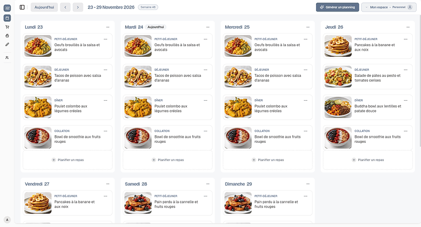

# Mealo Planner

Une application web développée avec Laravel, Inertia.js et React (TypeScript), dédiée à l’organisation des repas au quotidien.
Elle repose sur quatre fonctionnalités principales :

- La gestion et la découverte de recettes, notamment grâce à de l’IA générative.
- La planification manuelle ou algorythmique des repas.
- La génération de listes de courses à partir des repas planifiés.
- L’organisation de ces fonctionnalités au sein d’espaces personnels ou partagés.
<br/>



## Prérequis

- PHP 8.2+ ;
- Composer ;
- Node.js 22 ;
- pnpm 10 ;
- SQLite.

## Installation

Installer les dépendances backend :

```bash
composer install
```

Installer les dépendances frontend :

```bash
pnpm install
```

Créer le fichier d'environnement local :

```bash
cp .env.example .env
```

Générer la clé applicative Laravel :

```bash
php artisan key:generate
```

Créer la base de données SQLite :

```bash
touch database/database.sqlite
```

Renseigner les mots de passe utilisés par les utilisateurs créés par les seeders :

```dotenv
USERS_DEV_PASSWORD=...
USERS_TEST_PASSWORD=...
```

Optionnel pour l'installation, mais requis pour générer du contenu IA : renseigner une vraie clé OpenRouter.

```dotenv
OPEN_ROUTER_API_KEY=...
```

Appliquer les migrations puis charger les données initiales :

```bash
php artisan migrate --seed
```

## Démarrage

Lancer l'application en développement :

```bash
composer dev
```

## Documentation

La description de l'architecture backend et frontend, des tests et de l'intégration continue est disponible dans la [documentation technique](docs/documentation-technique.md).
