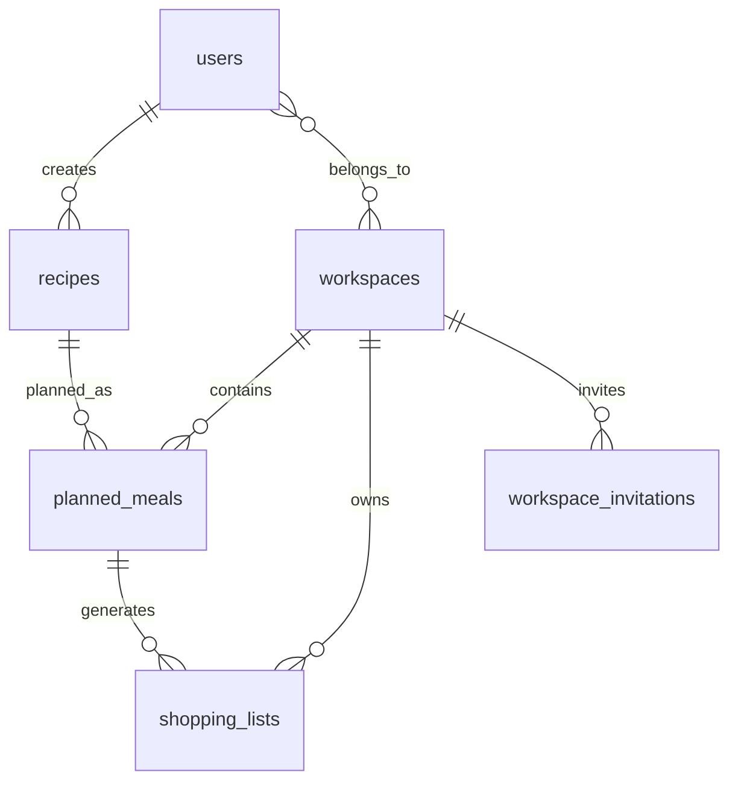
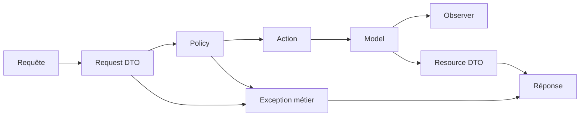
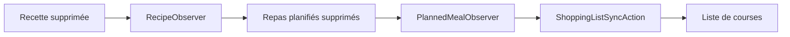
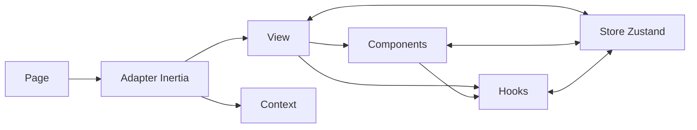
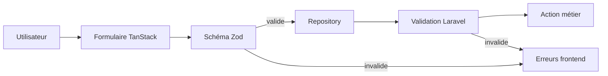

# Documentation technique

## Sommaire

- [Backend](#backend)
- [Frontend](#frontend)
- [Intégration continue](#intégration-continue)

## Backend

### Stack technique

**Application**

- **PHP 8.2+** — langage du backend ;
- **Laravel 12** — framework applicatif (routing, Eloquent, queues) ;
- **Inertia.js (adapter Laravel)** — rendu des pages React sans API REST dédiée ;
- **Laravel Fortify** — authentification.

**Données et autorisations**

- **Eloquent** — ORM et modélisation des entités ;
- **PostgreSQL** — base de données en production ;
- **SQLite** — base de données en développement et pour les tests ;
- **Spatie Laravel Data** — DTOs typés pour la validation et la sérialisation ;
- **Spatie Permission** — rôles et permissions par workspace.

**IA et tâches asynchrones**

- **Laravel AI SDK** — génération des visuels de recettes ;
- **Jobs et queues Laravel** — traitements asynchrones ;
- **Microservice AdonisJS, LangGraph et LangChain** — génération des recettes via une API dédiée.

**Tests et qualité**

- **Pest**, **Larastan** (PHPStan niveau 10) et **Laravel Pint**.

### Modèle de données

Le diagramme complet est disponible dans [Modélisation des données](modelisation-donnees.md) ; sa source Mermaid est [erd.mmd](erd.mmd).



### Traitement d'une requête

Le Controller orchestre la requête HTTP et délègue validation, autorisation, logique métier, persistance et sérialisation aux composants spécialisés.

| Composant | Responsabilité |
| --- | --- |
| `Request DTO` | Valider et transformer les données reçues. |
| `Policy` | Décider si l'action est autorisée. |
| `Action` | Exécuter la logique métier. |
| `Model` | Lire ou persister les données. |
| `Observer` | Réagir aux événements Eloquent. |
| `Resource DTO` | Préparer les données envoyées au frontend. |
| `Message / Exception` | Centraliser les retours utilisateur. |



### DTOs et autorisations

Les Request DTOs Laravel Data définissent les règles de validation et donnent aux Actions des données typées. Les Resource DTOs adaptent les Models aux besoins de l'interface, sans exposer directement leur structure.

Les Policies protègent les opérations métier. Les recettes sont modifiables par leur créateur ; les workspaces s'appuient sur les rôles `owner`, `editor` et `viewer`, ainsi que sur des permissions ciblées telles que `workspace.planned-meal.store`.

### Actions, Observers et messages

Les Actions isolent les traitements associés à une opération afin de limiter la logique dans les Controllers et de faciliter les tests. Les Observers réagissent au cycle de vie Eloquent : par exemple, la suppression d'une recette supprime ses repas planifiés et déclenche la synchronisation des listes de courses.

Les messages de succès et les exceptions métier utilisent le trait `HasDefaultMessage`. Celui-ci centralise la formulation par défaut et, si nécessaire, sa clé de traduction.



### Tests backend

`tests/TestCase.php` centralise `RefreshDatabase`, `TestDatabaseSeeder` et les traits de contexte qui préparent utilisateurs, workspaces, recettes, repas planifiés et listes de courses.

Les tests d'intégration contrôlent les Actions, les effets en base, les autorisations et les synchronisations sans passer par HTTP. Les tests fonctionnels vérifient les routes, la validation, la session, les redirections, les messages et les effets visibles pour l'utilisateur.

| Trait de contexte | Rôle |
| --- | --- |
| `HasUserContext` | Prépare les profils utilisateur. |
| `HasWorkspaceContext` | Crée workspaces, membres, invitations et rôles. |
| `HasRecipeContext` | Prépare les recettes et leurs relations. |
| `HasPlannedMealContext` | Prépare les scénarios de planning. |
| `HasShoppingListContext` | Retrouve la liste d'un workspace pour une semaine. |

## Frontend

### Stack technique

- **Inertia.js**, **React 19**, **TypeScript**, **Vite** et **Wayfinder** pour l'application ;
- **Tailwind CSS**, **DaisyUI**, **Radix UI**, **Headless UI** et **Lucide React** pour l'interface ;
- **TanStack Form**, **Zod**, **Zustand** et **i18next** pour les données et formulaires ;
- **Vitest**, **Playwright**, **Testing Library**, **Storybook**, **ESLint** et **Prettier** pour la qualité.

### Architecture orientée feature

| Emplacement | Rôle |
| --- | --- |
| `resources/js/pages/` | Points d'entrée Inertia. |
| `resources/js/app/features/` | Modules organisés par domaine fonctionnel. |
| `inertia.adapter.tsx` | Liaison entre les props Inertia et le contexte de la feature. |
| `views/` | Composition des écrans. |
| `components/` | Blocs d'interface de la feature. |
| `hooks/`, `stores/`, `repositories/` | Comportements, état partagé et échanges backend. |
| `app/components/`, `app/hooks/`, `app/stores/` | Éléments transversaux. |
| `app/data/`, `types/`, `app/locales/` | Données, types et traductions. |

Les pages Inertia restent légères : elles montent l'Adapter et la View de la feature. L'Adapter récupère les props avec `usePage()` et les rend disponibles par Context, ce qui évite de les propager manuellement.



### Formulaires et repositories

`useAppForm` pilote les valeurs saisies et exécute les schémas Zod. Une validation Laravel reste appliquée côté serveur avant l'Action métier. Les repositories isolent l'utilisation du routeur Inertia et exposent les opérations, états de chargement et erreurs aux Views et Components.



Les schémas Zod valident et transforment les données à l'exécution ; `z.infer` permet d'en déduire les types TypeScript. La compatibilité de type ne garantit pas une stricte identité avec les contraintes Laravel.

## Intégration continue

GitHub Actions exécute deux workflows sur les `push` et les `pull_request` vers `develop` et `main` :

- `.github/workflows/tests.yml` installe l'application, construit les assets et lance Pest ;
- `.github/workflows/quality.yml` exécute les contrôles de qualité et d'analyse statique.

Le workflow de tests prépare PHP, Composer, pnpm et Node.js, génère les routes Wayfinder, construit Vite, prépare Laravel, applique les migrations et les seeders, puis lance les tests.

```bash
composer install --no-interaction --prefer-dist --optimize-autoloader
php artisan wayfinder:generate --with-form
pnpm run build
php artisan migrate:fresh --seed --force
./vendor/bin/pest
```

Le workflow qualité vérifie PHPStan, Pint, TypeScript, Prettier et ESLint.

```bash
./vendor/bin/phpstan analyse app --memory-limit=2G
vendor/bin/pint
pnpm run types
pnpm format
pnpm lint
```
